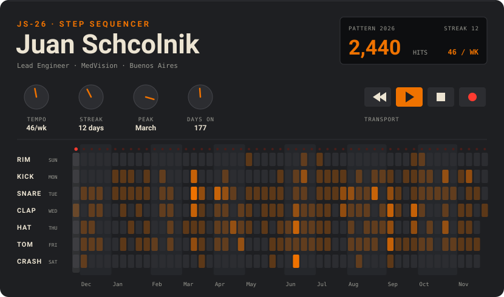
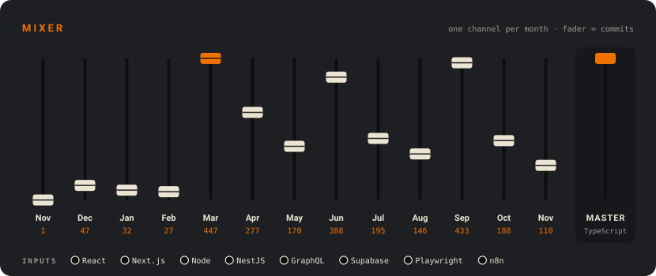

### Liner notes

Film-music composer turned software engineer. I lead engineering at MedVision. Every lit pad up there is a day I shipped something; the brighter the pad, the louder the day.

<b>Drop me a beat:</b> <a href="mailto:schcolnikj@gmail.com">schcolnikj@gmail.com</a> · <a href="https://linkedin.com/in/juanschcolnik">LinkedIn</a> · <a href="https://juanschcolnik.vercel.app/">Portfolio</a>

